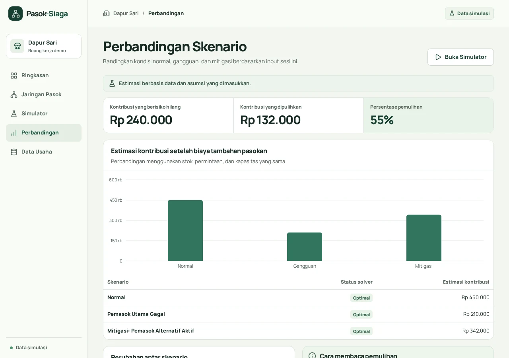

# RantaiTangguh

RantaiTangguh membantu UMKM produsen makanan melihat ketergantungan pemasok, mencoba skenario gangguan, dan memilih rencana produksi dari stok yang tersedia. Demo **Dapur Sari** menggunakan data simulasi tanpa akun.

[Buka demo RantaiTangguh](https://rantaitangguh.vercel.app/) · [Dokumentasi API produksi](https://rantaitangguh-api.vercel.app/docs)

- **Jaringan Pasok** menampilkan hubungan pemasok, bahan, dan produk dengan graf interaktif dan daftar untuk layar kecil.
- **Simulator** menghitung produksi dan pembelian alternatif dari stok, permintaan, resep, kapasitas, dan tanggal kedatangan. FastAPI menjalankan Google OR-Tools CP-SAT.
- **Perbandingan** menunjukkan dampak normal, gangguan, dan mitigasi. **Data Usaha** memungkinkan perubahan parameter dan reset demo.

## Jalankan lokal

Siapkan Node.js 22 atau lebih baru, npm, dan [uv](https://docs.astral.sh/uv/getting-started/installation/). `uv` menggunakan Python 3.12 sesuai `.python-version`. Perintah berikut berjalan di Bash dan PowerShell. Jalankan masing-masing dari root repository di terminal terpisah.

**API**

```bash
cd apps/api
uv sync --locked
uv run --locked uvicorn app.main:app --reload
```

**Web**

```bash
cd apps/web
npm ci
npm run dev
```

Buka `http://localhost:3000` dan pilih **Coba Demo Dapur Sari**. OpenAPI interaktif tersedia di `http://localhost:8000/docs`. Untuk override pengaturan, salin `.env.example` API menjadi `.env` dan tambahkan `--env-file .env` ke perintah Uvicorn. Untuk web, salin `.env.example` menjadi `.env.local` dan ubah `NEXT_PUBLIC_API_BASE_URL` bila API ada di host lain. Origin web harus masuk ke `CORS_ORIGINS` API.

## Verifikasi

Jalankan dari `apps/api`:

```bash
uv run --locked pytest
```

Jalankan dari `apps/web` setelah `npm ci`:

```bash
npm run lint
npm run typecheck
npm test
npm run build
npx playwright install chromium firefox
npm run test:e2e
```

Playwright dapat menyalakan API dan build web secara otomatis. Hentikan server lokal lama jika menempati port 3000 atau 8000 dengan konfigurasi yang berbeda.

## Hasil demo yang diharapkan

| Skenario | Roti | Kue kering | Tepung terpakai | Estimasi kontribusi setelah biaya tambahan pasokan |
|---|---:|---:|---:|---:|
| Normal | 100 | 30 pak | 28 kg | Rp450.000 |
| Pemasok utama gagal | 20 | 30 pak | 8 kg | Rp210.000 |
| Mitigasi | 68 | 30 pak | 20 kg | Rp342.000 |

Mitigasi memakai 12 pak tepung dari pemasok alternatif dengan premium Rp12.000. Estimasi yang pulih adalah Rp132.000 atau 55% dari Rp240.000 yang terancam. Semua nilai berasal dari data dan asumsi yang dimasukkan untuk satu batch produksi.



[Halaman pembuka](docs/screenshots/landing.webp) · [Jaringan Pasok di layar 360 px](docs/screenshots/mobile-network.webp)

## Dokumentasi

- [Kebutuhan produk](docs/PRODUCT_REQUIREMENTS.md) dan [rencana implementasi](docs/IMPLEMENTATION_PLAN.md)
- [Model data](docs/DATA_MODEL.md), [model optimasi](docs/OPTIMIZATION_MODEL.md), dan [kontrak API](docs/API_CONTRACT.md)
- [Pengujian](docs/TEST_PLAN.md), [deploy](docs/DEPLOYMENT.md), dan [batas model](docs/ASSUMPTIONS_AND_LIMITATIONS.md)
- [Skrip demo](docs/DEMO_SCRIPT.md) dan [template wawancara](docs/USER_VALIDATION_TEMPLATE.md)
- [Lisensi repository](LICENSE)
